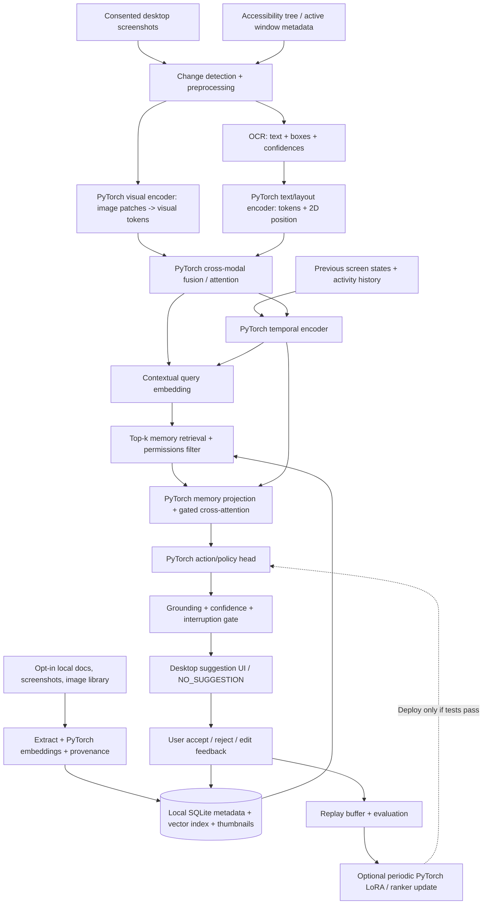

# SOMA — Screen-Observing Memory and Action

**Build specification | v0.1 | PyTorch-first**

SOMA is a **local-first, continually adapting desktop companion**. It interprets a user's *current screen*, combines that observation with *relevant personal memories* and *recent activity*, and **suggests** the next useful action. It learns immediately via memory updates and gradually via validated PyTorch parameter updates.

> **Core requirement:** Implement the learnable architecture, inference orchestration, training objectives, and evaluation in **PyTorch** (`torch`, `torch.nn`, `torch.optim`). Pretrained PyTorch checkpoints may bootstrap perception. Do **not** treat a remote LLM API or a collection of prompts as the model architecture.
>
> **Safety and privacy:** Explicit opt-in to screen capture, local file indexing, and any learning from interactions. Default to suggestion-only mode. Never execute actions without approval. All personal data stays local by default.

---

## 1. Product goal

The agent should answer three questions while someone works:

1. **What is happening?** Detect current application, readable text, UI elements, visual context, active task, and relevant changes over time.
2. **What matters to this user?** Retrieve relevant preferences, files, prior activity, and response feedback from a permissioned multimodal memory store.
3. **What should happen next?** Rank possible next actions, including **`NO_SUGGESTION`**, and offer a timely, grounded recommendation with a reason and evidence.

Example: User edits Python in VS Code, a test fails, and memory says they prefer inspecting tracebacks before changing code. SOMA suggests inspecting the traceback and shows the affected file and line. It does **not** autonomously rewrite code.

### Non-goals for the first release

- Training a foundation vision-language model from scratch.
- Perfect recognition of any desktop UI or intent.
- Fine-tuning after every click or collecting private data without consent.
- Automated control of browsers, terminals, financial workflows, or messages.
- A continuously active camera or microphone; the MVP captures the **screen only**.

---

## 2. End-to-end architecture



### Critical architectural corrections

- **Text content is sequential; a screen is 2D.** Preserve text bounding boxes, UI element coordinates, visual patch positions, and the relative arrangement of content. Multi-scale visual features are **optional**, not inherently unnecessary. Start with a single visual resolution and add a pyramid if tiny controls or icons are missed.
- **Flattening features is not the same as OCR.** OCR is a recognition task; learned patch tokens must preserve positional information, and a trained recognition head/decoder is needed to read characters. Bootstrap OCR with an existing engine in v0.1 rather than training it from scratch.
- **Memory is external to model weights.** A local DB can be logically integrated as an attention-accessible module, but storing arbitrary files inside neural parameters would be difficult to update, retrieve, delete, and audit.
- **'Trains itself on the go' has two speeds:** immediate memory/ranker adaptation; optional slow, offline, validated parameter updates. Do not backpropagate on every screenshot.
- **Suggestions and actions differ.** A suggestion is text plus a proposed UI target, not permission to click/type/execute.

---

## 3. Functional modules and tensors

Notation: `B` = batch, `C` = channels, `H/W` = image dimensions, `N` = visual tokens, `L` = OCR tokens, `K` = retrieved memories, `T` = timesteps, `D` = fusion dimension (default 512).

| Module | Input | Output | Implementation / notes |
|---|---|---|---|
| Screen sampler | Desktop video/window data | Screenshot `[B,3,H,W]`, app/window metadata | `mss` / OS screen APIs; event-driven, rate-limited |
| Preprocessor | Screenshots | Normalized/resized image, change regions | PyTorch/TorchVision transforms; redact sensitive regions before persistence |
| OCR + UI parser | Image | UTF-8 text, boxes, confidence, role | PaddleOCR or equivalent; accessibility APIs preferred for reliable labels/roles |
| Visual encoder `E_v` | Image `[B,3,448,448]` | Visual tokens `[B,N,D]` | PyTorch ViT/SigLIP-compatible encoder, patch positional embeddings, projector |
| Text/layout encoder `E_t` | OCR IDs `[B,L]` + boxes `[B,L,4]` | Text tokens `[B,L,D]` | `nn.Embedding`, 2D position projection, `nn.TransformerEncoder` |
| Screen fusion `F` | Visual/text tokens and masks | Screen state `[B,D]` + tokens | `nn.MultiheadAttention` or `nn.TransformerEncoder`; mask padding |
| Temporal encoder | `[B,T,D]` | Context `[B,D]` | Small causal Transformer or GRU; includes app/actions/elapsed time |
| Memory retriever | Screen/context vector `[B,D]` | IDs, embeddings `[B,K,D]`, metadata | SQLite + FAISS or `sqlite-vec`; prefilter ACLs before scoring |
| Memory fusion | State `[B,D]`, retrieved `[B,K,D]` | Personalized context `[B,D]` | Gated cross-attention with `NO_MEMORY` fallback |
| Candidate generator | Screen + memory + task | Candidate actions + target references | Start with deterministic UI/task templates; optionally PyTorch text decoder later |
| Policy/ranker | Context `[B,D]`, candidates | Scores `[B,K_a+1]` | PyTorch ranking MLP or transformer scorer; extra `NO_SUGGESTION` class |
| Feedback learner | Accepted/rejected/edited suggestions | Updated memory, optional training set | Feedback store and asynchronous training job with replay |

**Shapes must remain explicit.** Some pretrained vision backbones output `[B,D]` pooled features; for cross-attention, use patch/token outputs, not just global pooled embeddings.

### OCR and screen geometry

For each recognized element, store:

```json
{
  "text": "Run tests",
  "bbox_xyxy_normalized": [0.41, 0.11, 0.49, 0.15],
  "confidence": 0.98,
  "source": "ocr",
  "ui_role": "button",
  "window_id": "active-editor",
  "timestamp_ms": 0
}
```

Values above are illustrative. OCR text should not be assumed to be inherently associated with a clickable UI element. Join OCR with accessibility roles, or use a trained screen-parser/grounding module.

### PyTorch components that **must** be present

- `nn.Module` for each neural component; typed, documented `forward` methods.
- `nn.Embedding` for token IDs and learned type/app embeddings.
- `nn.Linear` to project vision, layout, and memory vectors into a shared hidden dimension.
- `nn.LayerNorm`, residual connections, dropout as appropriate.
- `nn.MultiheadAttention` for visual↔text and context↔memory attention, or `nn.TransformerEncoder`/`nn.TransformerDecoder` where suitable.
- `torch.nn.functional.scaled_dot_product_attention` where efficient attention is justified.
- `nn.GRU` or a causal `nn.TransformerEncoder` for temporal state.
- A trainable `nn.Sequential` policy/ranking head.
- `torch.utils.data.Dataset`, `DataLoader`, `torch.optim.AdamW`, gradient clipping, mixed precision (`torch.autocast`) where supported.
- Checkpointing through `state_dict`, reproducible seeds, and tests for serialization.

Libraries such as `torchvision`, Hugging Face Transformers, PEFT, and timm can supply **PyTorch-native** pretrained modules. Keep custom SOMA fusion, memory, temporal, and policy components in this repository.

---

## 4. Repository structure

```text
soma/
├── README.md
├── pyproject.toml
├── configs/
│   ├── dev.yaml
│   └── train.yaml
├── soma/
│   ├── capture/
│   │   ├── screen.py              # event-triggered consented capture
│   │   ├── redaction.py           # excluded apps/windows, PII masks
│   │   └── accessibility.py       # optional OS-native accessibility tree
│   ├── perception/
│   │   ├── ocr.py                 # OCR adapter, not trained from scratch
│   │   ├── screen_parser.py       # UI elements + coordinates
│   │   └── preprocess.py
│   ├── models/
│   │   ├── visual_encoder.py      # PyTorch image tokens
│   │   ├── text_layout_encoder.py # PyTorch text + bbox tokens
│   │   ├── screen_fusion.py       # PyTorch multimodal attention
│   │   ├── temporal_encoder.py    # PyTorch causal context
│   │   ├── memory_fusion.py       # PyTorch retrieved-memory attention
│   │   ├── action_policy.py       # PyTorch candidate scorer + abstain
│   │   └── soma_model.py          # end-to-end nn.Module / tensors
│   ├── memory/
│   │   ├── sqlite_store.py        # encrypted or OS-protected metadata
│   │   ├── vector_index.py        # similarity search
│   │   ├── ingestion.py           # explicit user-selected sources
│   │   ├── retrieval.py           # permission + relevance + recency
│   │   └── deletion.py            # remove raw records and rebuild index
│   ├── policy/
│   │   ├── candidate_generator.py
│   │   ├── grounding.py           # verify target on current screen
│   │   └── safety_gate.py         # permissions/confidence/cooldown
│   ├── learning/
│   │   ├── feedback.py
│   │   ├── replay_buffer.py
│   │   ├── datasets.py
│   │   ├── losses.py
│   │   ├── trainer.py
│   │   └── evaluator.py
│   ├── runtime/
│   │   ├── pipeline.py
│   │   ├── scheduler.py           # budget inference, backpressure
│   │   └── telemetry.py           # opt-in local metrics
│   ├── api/
│   │   └── local_api.py           # localhost IPC/API, authenticated
│   └── ui/
│       └── desktop/              # tray + overlay + feedback controls
├── scripts/
│   ├── build_memory.py
│   ├── train_ranker.py
│   ├── evaluate.py
│   └── run_desktop.py
└── tests/
    ├── test_tensor_shapes.py
    ├── test_cross_attention_masks.py
    ├── test_memory_acl.py
    ├── test_no_suggestion.py
    ├── test_feedback_replay.py
    ├── test_model_checkpoint.py
    ├── test_privacy_redaction.py
    └── test_slow_runtime.py
```

---

## 5. Minimal PyTorch architecture contract

The following is an **interface sketch**, not a complete runnable model. Build the modules as separate testable implementations, rather than writing a monolithic loop.

```python
from dataclasses import dataclass
import torch
from torch import nn

@dataclass
class SomaBatch:
    images: torch.Tensor          # [B, 3, H, W]
    ocr_ids: torch.Tensor         # [B, L]
    ocr_boxes: torch.Tensor       # [B, L, 4] normalized coordinates
    ocr_padding_mask: torch.Tensor # [B, L], True = PAD
    history: torch.Tensor         # [B, T, D]
    memory_embeddings: torch.Tensor   # [B, K, D]
    memory_padding_mask: torch.Tensor # [B, K], True = PAD
    candidate_embeddings: torch.Tensor # [B, A, D]

class SomaModel(nn.Module):
    def __init__(self, vision_encoder, text_layout_encoder,
                 screen_fusion, temporal_encoder, memory_fusion,
                 action_policy):
        super().__init__()
        self.vision_encoder = vision_encoder
        self.text_layout_encoder = text_layout_encoder
        self.screen_fusion = screen_fusion
        self.temporal_encoder = temporal_encoder
        self.memory_fusion = memory_fusion
        self.action_policy = action_policy

    def forward(self, batch: SomaBatch) -> dict[str, torch.Tensor]:
        visual_tokens = self.vision_encoder(batch.images)       # [B, N, D]
        text_tokens = self.text_layout_encoder(
            batch.ocr_ids, batch.ocr_boxes, batch.ocr_padding_mask
        )                                                        # [B, L, D]
        screen_state = self.screen_fusion(
            visual_tokens, text_tokens, batch.ocr_padding_mask
        )                                                        # [B, D]
        state = self.temporal_encoder(screen_state, batch.history) # [B, D]
        context = self.memory_fusion(
            state, batch.memory_embeddings, batch.memory_padding_mask
        )                                                        # [B, D]
        scores = self.action_policy(
            context, batch.candidate_embeddings
        )                                                        # [B, A + 1]
        return {"screen_state": screen_state,
                "personalized_context": context,
                "action_logits": scores}
```

The `A + 1` score dimension includes a **trainable abstention option** (`NO_SUGGESTION`). Ensure the model works if OCR is empty, memory is empty, or all candidates are blocked. Empty attention inputs require explicit handling, not softmax over all-masked keys.

### Fusion options

**Initial:** encode visual patch tokens + OCR tokens, concatenate with modality/type and positional embeddings, and process with a small Transformer. Mask padded OCR tokens. Pool with a learned query token or attention pooling to `[B,D]`.

**Next:** bidirectional cross-attention between visual and text tokens; memory retrieval query derived from fused screen and history. Compare by latency and grounded accuracy, not architectural complexity.

**Later:** optional patch pyramids or region proposals for small UI targets; end-to-end text generation decoder if a constrained recommendation vocabulary proves inadequate.

---

## 6. Intelligent local memory

### Storage design

Use **SQLite** for metadata, permissions, provenance, feedback, recency, and durable records; use **FAISS** / `sqlite-vec` for nearest-neighbor embedding search. Store raw files in their original locations; only persist a reference/derived summary/thumbnail where the user permits it. Protect sensitive data using platform-supported storage encryption or an encrypted local database; restrict filesystem permissions.

Core schema:

```sql
CREATE TABLE memory_items (
  id TEXT PRIMARY KEY,
  source_uri TEXT,
  source_type TEXT NOT NULL,          -- image, document, preference, feedback, UI-event
  user_approved INTEGER NOT NULL,
  text_summary TEXT,
  embedding_ref TEXT,
  created_at TEXT NOT NULL,
  updated_at TEXT NOT NULL,
  expires_at TEXT,
  tags_json TEXT,
  provenance_json TEXT NOT NULL
);
CREATE TABLE feedback_events (
  id TEXT PRIMARY KEY,
  suggestion_id TEXT NOT NULL,
  outcome TEXT NOT NULL,              -- accepted, rejected, edited, ignored
  observed_at TEXT NOT NULL,
  context_ref TEXT,
  consented_for_training INTEGER NOT NULL DEFAULT 0
);
```

Index semantics:

1. User selects an allowed folder/source. Never silently index an entire home directory.
2. Extract approved text and images, embed using PyTorch text/image encoders, store embeddings and provenance.
3. At runtime, compute a query from screen + history and retrieve top-k **permission-filtered** items.
4. Rerank by relevance, recency, user preference, and source trust.
5. Pass memory embeddings and short summaries into gated cross-attention.
6. Give users **view, correct, forget, and delete** controls; purge cache/index/derived copies when deleting.

Handle conflicting memories, outdated preferences, false inferences, and uncertainty. Treat remembered content and screen text as **untrusted task data**, never as privileged executable instructions.

---

## 7. Temporal modeling and action proposal

A single screenshot is incomplete: keep a **short rolling state history**, not an unrestricted permanent screen recording.

Inputs can include `{screen_embedding, app_id, time_delta, OCR_change, last_user_action}`. A causal GRU/Transformer predicts an intent/context vector without seeing future frames.

The action generator creates a bounded candidate set, for example:

- `NO_SUGGESTION`
- `EXPLAIN_ERROR(error_region)`
- `OPEN_RELEVANT_FILE(file_ref)`
- `COMPARE_WITH_PRIOR_WORK(memory_ref)`
- `SUGGEST_NEXT_STEP(text)`
- `ASK_CLARIFYING_QUESTION(text)`

For v0.1, action candidates come from **templates and observable UI affordances**; a PyTorch scorer ranks them. The UI displays a concise suggestion, confidence/calibration indicator if validated, supporting visual/text evidence, and feedback choices. Never expose or recommend files for which indexing/access was not authorized.

**Interruption policy:** `NO_SUGGESTION` must often win. Enforce cooldowns, app-specific quiet modes, duplicate suppression, and a configurable relevance threshold. If an action references a UI target, reverify that target on the latest frame before presenting or performing any user-approved operation.

---

## 8. Training: PyTorch-first, staged

### Stage A — Bootstrap without bespoke dataset

- Load pretrained, properly licensed PyTorch image backbone and pretrained OCR model.
- Initially freeze large visual and text backbones.
- Implement/train a small screen fusion layer, temporal layer, memory gate, and recommendation ranker in PyTorch.
- Use synthetic **non-sensitive** GUI scenarios and manually authored task/action examples for smoke tests. Do not represent synthetic performance as real-world quality.

### Stage B — Supervised recommendation learning

Dataset item: a consented screen summary/embedding, recent state history, retrieved memories, candidate actions, and human-labeled best action (including `NO_SUGGESTION`). Include hard negatives and cases in which the correct behavior is silence.

Example losses:

```python
# scores: [B, A+1] — includes NO_SUGGESTION
loss_policy = torch.nn.functional.cross_entropy(scores, target_action_index)

# Optional: contrastive retrieval alignment using labeled positive/negative memories
# Optional: ranking loss against candidate preferences
loss = loss_policy + lambda_retrieval * loss_retrieval
```

Start with `loss_retrieval=0` until valid retrieval supervision exists. Evaluate against a fixed holdout set and calibrate abstention/notification thresholds.

### Stage C — Feedback-based adaptation (first version)

- Store explicit accept/reject/edit feedback with consent and source provenance.
- Improve immediate ranking with a lightweight online preference model or bandit **without rewriting base weights**.
- Batch positive and negative examples in a replay buffer; avoid learning from ambiguous ignored suggestions as though they were rejected.

### Stage D — Selective continual fine-tuning (optional)

- Train small adapters / LoRA or the policy head with `AdamW` on opt-in user feedback **plus replay samples**.
- Maintain base checkpoint, train/validation split, gradient clipping, and limits on training frequency and resource use.
- Measure forgetting on previously supported apps/tasks; compare against the current model.
- Deploy a candidate only if it improves predefined metrics without violating safety/privacy gates; otherwise rollback.
- **Never** directly optimize on raw observed user behavior as proof of intent without confirming labels.

### Training infrastructure

- `torch.utils.data.DataLoader` and seeded data splits.
- Use `torch.autocast` (CUDA where available), `torch.no_grad()` / `torch.inference_mode()` for inference, and `.eval()` on frozen backbones.
- Save checkpoints as state dicts + config/version, not opaque serialized Python objects from untrusted sources.
- Log loss curves and offline evaluation locally; metrics export is opt-in.
- Device priorities: CUDA if available, otherwise CPU; automatic memory fallback and batching limits.

---

## 9. Desktop runtime and performance

**Recommended runtime loop:**

1. Confirm capture permission and that the foreground window is not excluded.
2. Detect meaningful screen change or user activity; skip identical frames.
3. Capture a frame; preprocess, run OCR/UI parsing and PyTorch visual encoder.
4. Fuse OCR, visual, and recent temporal representations.
5. Query local memory with permission checks; rerank relevant items.
6. Score proposed actions including abstention, run safety/interruptibility gate.
7. Show suggestion UI, or remain silent; collect explicit feedback only.
8. Record approved feedback in local memory; schedule bounded adaptation separately.

Runtime engineering:

- Use **event-triggered sampling**, adaptive frequency, cached image embeddings where safe, and a dedicated worker thread/process for heavy inference.
- Never block the desktop UI waiting for OCR/VLM computation; drop stale requests.
- Every suggestion references the **screen version** it was generated from; invalidate it after relevant UI changes.
- Profile capture, OCR, vision encoding, retrieval, fusion, ranker, and overlay separately.
- Track median and P95 *time from a meaningful change to a useful suggestion*. Start by measuring actual hardware, then establish a latency budget; do not promise fixed FPS or millisecond latency before benchmarks.

---

## 10. Privacy, safety, and user control (required before personal indexing)

- Explicit opt-in for screen capture, app monitoring, selected-folder indexing, feedback storage, and model training; each can be toggled independently.
- Visible active-state indicator and instant pause/stop; default off after installation until consent.
- Exclude password managers, private/incognito windows, banking, authentication prompts, and selected apps; minimize and redact secrets before storage.
- No ambient webcam/mic capture in the MVP. No collection of global keystrokes or passwords.
- Local-only by default; any remote inference requires separate informed consent and clear data-boundary disclosure.
- Permission filtering happens **before retrieval** as well as before display; no cross-user mixing.
- Treat OCR, webpages, PDFs, and memory as untrusted content: no tool execution or permission escalation from text seen on screen.
- No autonomous clicks, terminal commands, file modifications, communication, purchases, or credential handling. Later execution modes require explicit action-by-action approval, allowlists, and audit trails.
- Let users inspect/export/delete their memories and feedback; verify deletion of vector entries, thumbnails, and derived data.

---

## 11. Milestones and acceptance criteria

### M0 — Environment + PyTorch modules

**Deliver:** installable Python project, device selector, configuration, separate torch modules, and deterministic shape tests.

**Accept when:** `pytest` passes; random tensors flow from both image/text encoders through fusion to an `[B,A+1]` policy output; empty OCR/memory are handled without NaNs; save/load checkpoint preserves outputs in eval mode.

### M1 — Live screen understanding (no learning yet)

**Deliver:** desktop capture with explicit opt-in, foreground app metadata, OCR+boxes, screen encoder, debug overlay showing recognized text and UI regions.

**Accept when:** captured screen can be inspected locally; screen-coordinate mappings work across resizes; paused/excluded apps produce no capture; screenshots are not persisted by default.

### M2 — Local multimodal memory

**Deliver:** selected-folder indexing of text/image files, embeddings, SQLite/vector retrieval, source references, memory viewer and deletion.

**Accept when:** a test screen retrieves relevant allowed memory, excludes blocked sources, and deletion removes the entry from retrieval and derived storage.

### M3 — Action suggestions

**Deliver:** candidate generator, PyTorch temporal model, memory fusion, PyTorch action scorer, confidence/interruptibility gate, suggestion UI, user feedback.

**Accept when:** the agent can suggest a grounded next step in scripted GUI scenarios, remains silent on known low-value scenarios, does not repeat dismissed suggestions, and never executes without approval.

### M4 — Personalized improvement

**Deliver:** feedback collection, repeatable offline train/eval, replay-buffer updater, controlled adapter/ranker rollout.

**Accept when:** held-out personalized ranking improves over a fixed baseline; forgetting and intervention rate do not worsen beyond defined tolerances; a failed update rolls back deterministically.

### M5 — Research-grade improvements (only after baseline works)

Test **one variable at a time**:

- Single-scale ViT vs multi-scale visual features for tiny controls.
- OCR + visual tokens vs visual-only screen understanding.
- No memory vs retrieval memory vs gated memory attention.
- Current frame vs temporal context.
- Frozen weights + memory vs periodically fine-tuned adapters.
- Action classification vs constrained generative decoder.

---

## 12. Evaluation metrics and ablations

| Area | Metric | Expected interpretation |
|---|---|---|
| OCR | Character error rate (CER) / word error rate (WER) | Lower is better |
| UI grounding | Element match / point-in-target accuracy | Higher is better |
| Retrieval | Recall@k, nDCG@k, permission violations | High relevance; **zero** permission violations |
| Action proposal | Top-1 / top-k recommendation accuracy | Compare to scripted and human-labeled baselines |
| Personalization | Acceptance rate, edit rate, pairwise preference win rate | Must be interpreted alongside interruption rate |
| Silence policy | Unwanted suggestions per active hour | Lower is better at equivalent task helpfulness |
| Continual learning | Holdout gains, regression/forgetting rate | Improve without degrading prior competencies |
| Runtime | P50/P95 latency, GPU memory, CPU usage | Profile in real hardware and app contexts |
| Safety/privacy | Blocked-source leak tests, unapproved-execution count | Must equal zero in test suite |

Prepare a small *consented* set of GUI sessions with annotated “next useful action” labels. Compare against two baselines: (1) no-memory screen-only policy; (2) screen + retrieval without continual training. This shows which added complexity actually contributes.

---

## 13. Suggested dependencies

> Pin and test compatible versions at implementation time; exact packages and accelerator builds change.

```text
Core ML:         torch, torchvision, transformers, timm, safetensors
OCR / UI:        paddleocr (or modular alternative), accessibility APIs
Embeddings:      pretrained PyTorch CLIP/SigLIP-class encoders
Memory:          sqlite3, faiss-cpu or sqlite-vec
File extraction: pymupdf, python-docx, pillow (only for user-approved sources)
Desktop capture: mss, OS-native APIs
Desktop UI:      PySide6 or Tauri + local Python worker
Local service:   FastAPI or lightweight IPC (localhost-only, authenticated)
Training:        datasets, accelerate (optional), peft (optional)
Testing:         pytest, pytest-asyncio, hypothesis (optional)
Diagnostics:     torch.profiler, local metrics/logs
```

Use only one UI framework for the MVP. A Python worker plus PySide6 offers the shortest fully local path; desktop cross-platform polish can come later.

---

## 14. Prioritized instructions for the coding agent

1. Create the repository structure and tests **before** implementing advanced behavior.
2. Implement a **small genuine PyTorch neural pipeline** with explicit tensor contracts, masking, and a working `NO_SUGGESTION` class. A placeholder API call is not acceptable as a substitute for `SomaModel`.
3. Integrate a pretrained PyTorch visual encoder and existing OCR engine with clean adapters.
4. Build consent-gated capture, local memory indexing, and source-aware retrieval.
5. Add temporal state, memory attention, candidate scoring, and a non-invasive suggestion overlay.
6. Introduce feedback storage and offline supervised ranking; train on synthetic/consented data only.
7. Add optional adapter fine-tuning **after** evaluations, replay, regression tests, and rollback exist.
8. Implement each milestone with a runnable command, a short demo, measured performance, and tests.
9. Never quietly expand surveillance scope or autonomous computer-control permissions.
10. Record design decisions in `docs/DECISIONS.md`; benchmark single-scale vs multi-scale perception rather than assuming either is always superior.

### Immediate first deliverable

Run `python -m scripts.run_desktop` to launch a consent-first UI. With capture enabled, show current recognized OCR text, active application, and a **dummy but real PyTorch-produced** candidate score distribution (including `NO_SUGGESTION`). No personal file scan and no autonomous clicks until later milestones.

### Definition of done for v0.1

A user explicitly enables screen capture, selects a small personal-memory folder, and sees **context-sensitive, explainable, opt-in next-action suggestions**. The policy uses PyTorch multimodal/temporal/memory components, abstains when uncertain, accepts feedback, and can be evaluated reproducibly against a no-memory baseline. Any updates to trainable weights are gated by evaluation and rollback.
