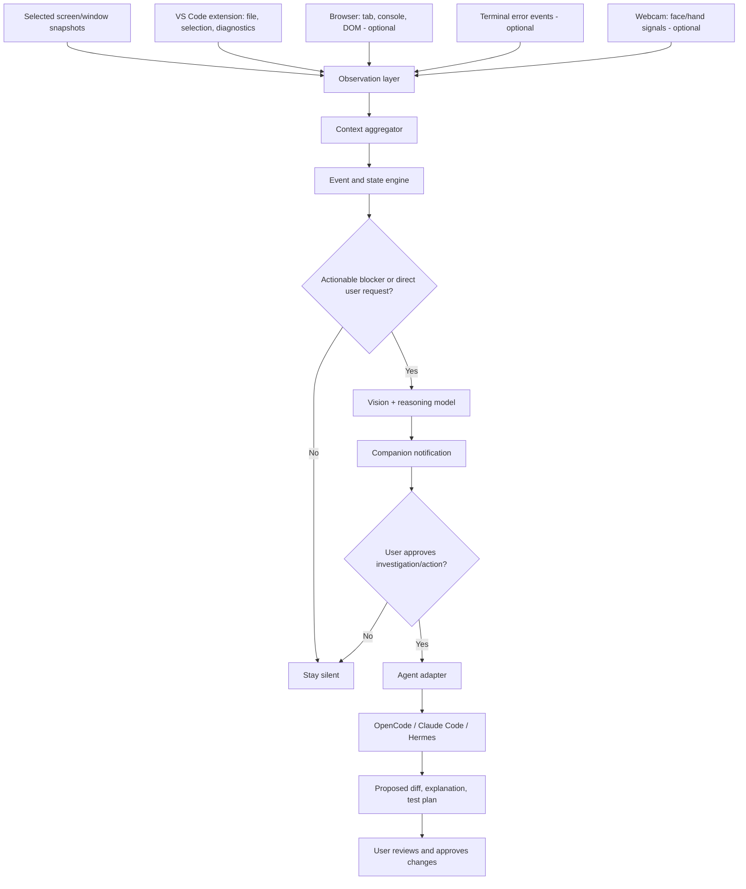

# Visual Coding Companion — Build Specification

## Goal

Build an always-available desktop coding companion that understands **what a developer is seeing and doing** across their IDE, terminal, and browser; detects actionable blockers; and delegates assistance to an existing coding-agent harness (OpenCode, Claude Code, or Hermes).

**Core principle:** Use computer vision to understand **rendered visual context** and native integrations to retrieve **exact structured context**. Do not try to extract all source code from screenshots.

**MVP scope:** A working local-first Windows desktop demo in approximately **5 development hours**, prioritizing VS Code, browser/terminal screenshots, and OpenCode. The webcam is optional and must not block completion.

## Target UX

- A small floating, always-on-top companion that can be opened via hotkey.
- The user chooses which windows/apps are observable; one-click **Pause observation**.
- The companion detects repeated diagnostics, failed builds, or a visibly broken preview.
- It combines the relevant screenshot with editor selection, file path, diagnostics, and recent terminal output (where available).
- It offers a concise explanation or a **Review proposed fix** action, rather than constantly interrupting.
- A configured coding agent investigates; file edits and shell commands require explicit approval in the MVP.
- The companion can be dismissed, muted, or given feedback on whether its suggestion helped.

## System Architecture



### Key modules

1. **Desktop shell:** Electron + React (TypeScript), local UI overlay, global hotkey, tray toggle, active observation indicator, selected-window capture. Keep overlay unobtrusive and click-through only when appropriate.
2. **IDE bridge:** VS Code extension emitting active workspace/file, selection or nearby code, visible editor range, diagnostics, save events, and optional test state to a loopback service.
3. **Visual perception:** Capture bounded screenshots upon relevant events or explicit requests; send images plus structured context to a multimodal model. Use timestamps and window identity to correlate evidence. Avoid continuous expensive frame analysis.
4. **Context/state engine:** Maintain short-lived observations, deduplicate repeated issues, detect workflow transitions, score intervention confidence, and enforce cooldowns.
5. **Agent adapter:** A provider-neutral interface that supplies a scoped task and context to OpenCode first, then optionally Claude Code/Hermes. Return proposed diffs, commands, and summaries to the UI.
6. **Privacy/permissions:** Local-first event store, per-app allowlist, sensitive-area exclusion, screenshot redaction where possible, controlled retention, and approval boundaries.

## Recommended stack

| Area | Initial choice | Why |
|---|---|---|
| Desktop UI | Electron + React + TypeScript | Native desktop window/tray/capture integration |
| IDE | VS Code Extension API | Structured selections, diagnostics, editor and workspace events |
| Screen capture | Electron `desktopCapturer` | User-selected desktop/window visual evidence |
| Service/event transport | Local Node.js server over loopback/WebSocket | Simple IPC between extension and desktop app |
| Multimodal reasoning | Configurable vision-capable LLM API | Interpret visible errors and broken UI |
| Agent execution | OpenCode SDK/server or CLI adapter | Delegate investigation and generate reviewable patches |
| Browser context, later | Chrome extension or Chrome DevTools Protocol | DOM, console, and network data are more reliable than screenshot OCR |
| Eye/face and hand gestures, later | MediaPipe Face Landmarker and Gesture Recognizer | Coarse attention and hands-free explicit commands |
| Local persistence | SQLite or JSON for MVP | User preferences, event history, suggestion feedback |
| Tool abstraction, later | MCP | Standard interfaces for additional agents and tools |

**Do not make webcam tracking a prerequisite.** Webcam-based gaze, mood, or frustration inference is unreliable and should never automatically authorize actions.

## Event pipeline

```text
VS Code diagnostics change / failing test / explicit hotkey / browser preview event
  → gather structured context and optional selected-window screenshot
  → normalize event with timestamp and app/window ID
  → deduplicate + update short-lived developer state
  → determine if there is enough evidence to assist
  → send limited, redacted context to vision model when needed
  → present a brief opt-in suggestion
  → on approval, ask configured coding agent to investigate
  → show proposed diff / commands / tests for review
  → record feedback and dismiss/cooldown
```

### Sample event contract

```ts
type DeveloperEvent = {
  id: string;
  timestamp: number;
  source: 'vscode' | 'desktop' | 'browser' | 'terminal' | 'webcam';
  kind: 'diagnostic' | 'failed_test' | 'window_change' | 'snapshot' | 'request' | 'gesture';
  workspaceId?: string;
  windowId?: string;
  filePath?: string;
  line?: number;
  summary: string;
  severity?: 'info' | 'warning' | 'error';
  // Prefer references to ephemeral encrypted/local data, not image bytes in logs.
  screenshotRef?: string;
};

type AssistanceProposal = {
  sourceEventIds: string[];
  reason: string;
  suggestedAction: 'explain' | 'investigate' | 'propose_patch';
  confidence: number;
  userApprovalRequired: true;
};
```

## Initial intervention rules

| Signal | Likely state | Behavior |
|---|---|---|
| Same error repeatedly, failed test or build | Debugging blocker | Suggest targeted investigation |
| Browser preview diverges from stated target | UI debugging | Offer screenshot-based layout diagnosis |
| Developer switches between docs and implementation | API integration | Offer contextual reference, without interrupting by default |
| Tests passing, frequent productive edits | In flow | Stay silent |
| User invokes hotkey | Explicit request | Analyze active window and IDE context immediately |
| Gesture observed (later) | Explicit control, if calibrated | Dismiss/open companion, never execute sensitive commands |

**Interruption policy:** Prompt only on explicit request, strong diagnostic evidence, or a repeated issue that crosses a configurable threshold. Deduplicate by issue fingerprint; apply per-issue cooldown and daily suggestion cap. All suggestions should be dismissible.

## Five-hour MVP build plan

### Hour 1 — Desktop shell
- Scaffold Electron + React/TypeScript app.
- Create small floating companion window with show/hide hotkey.
- Implement selected-window screenshot capture and clear capture indicator.
- Add **Pause**, **Analyze now**, and **Dismiss** controls.

**Done when:** User can capture one allowed application window and see the snapshot attached to a local observation.

### Hour 2 — VS Code bridge
- Scaffold companion VS Code extension.
- Subscribe to active editor/selection and diagnostics changes.
- Send normalized events via local loopback WebSocket/HTTP.
- Display file, position, and diagnostics in desktop UI.

**Done when:** A deliberate type error in VS Code appears in the companion with its correct file and diagnostic message.

### Hour 3 — Vision/context reasoning
- Implement on-demand screenshot + structured context prompt.
- Call a configurable vision-capable model using user-provided credentials.
- Return compact structured output: observation, evidence, likely cause, next step, confidence.
- Implement error handling and a hard cap on uploaded screenshot size.

**Done when:** Analyze now explains a visible error or broken preview using both image and IDE context.

### Hour 4 — Coding agent handoff
- Implement one OpenCode adapter; keep a provider-neutral interface.
- Pass workspace path, diagnostic, relevant excerpt, and model explanation.
- Ask agent to investigate and produce a proposed diff and test plan.
- Show the proposed changes before executing or applying them.

**Done when:** A user-approved investigation yields a reviewable fix proposal for a test bug.

### Hour 5 — Proactive logic and polish
- Detect persistent or repeated errors; offer assistance without requiring hotkey.
- Add cooldown, pause, selected-app allowlist, feedback controls.
- Handle disconnected IDE bridge, unavailable model, and failed agent execution.
- Test happy path plus permission-denial and sensitive-window scenarios.

**Done when:** A repeated diagnostic causes at most one relevant suggestion, and no changes occur without the user's approval.

## Repo layout

```text
visual-coding-companion/
├── apps/
│   └── desktop/              # Electron main/preload + React renderer
├── extensions/
│   └── vscode/               # Diagnostics and editor context integration
├── packages/
│   ├── shared/               # Typed events and contracts
│   ├── context-engine/       # Event fusion, state, rules, cooldown
│   ├── vision/               # Snapshot processing and model adapter
│   └── agents/               # OpenCode initially, other harnesses later
├── docs/
│   └── VISUAL_CODING_COMPANION.md
├── .env.example             # Variable names only, no secrets
└── README.md
```

## Example end-to-end demo

1. Launch companion and opt into VS Code + one browser preview window.
2. Open a Next.js project and deliberately trigger an exception in `Dashboard.tsx`.
3. IDE diagnostics or observed console error triggers an event.
4. Companion correlates the error with selected-file context and, if useful, the browser screenshot.
5. It displays: **“The dashboard accesses data that may be undefined. Investigate?”**
6. User selects **Investigate**.
7. OpenCode inspects the relevant code and proposes a guarded access/fallback plus a test.
8. Companion displays the diff and asks for explicit approval before modification or command execution.
9. User accepts or dismisses; companion records whether the suggestion helped.

## Privacy, safety, and reliability constraints

- **Opt-in capture:** No background screen or webcam capture before permission and clear UI disclosure.
- **Allowlist:** Capture only selected applications/windows, not the entire desktop by default.
- **Private surfaces:** Exclude password managers, credential prompts, private/incognito sessions, and user-specified windows.
- **Data minimization:** Prefer IDE structured context over screen OCR. Crop, mask, or redact screenshots where possible.
- **Local retention:** Default to ephemeral frames; never retain raw webcam footage. Provide clear/delete controls for session observations.
- **Action approval:** Require confirmation for edits, shell commands, network actions, destructive operations, and cross-app automation. Never treat gesture/eye movement as authorization.
- **Secrets:** Do not place API keys in renderer logs, screenshots, prompts, or version control. Handle provider secrets in a protected main-process/local service boundary.
- **Uncertainty:** Label visually inferred problems as hypotheses; use diagnostics/tests for confirmation.
- **No emotion claims:** Gaze and face landmarks are weak signals of attention and cannot reliably establish frustration or comprehension.
- **Platform support:** Windows-first MVP; test capture and accessibility behavior on each OS before claiming cross-platform support.

## Non-goals for MVP

- Continuous full-screen recording or video streaming to an LLM.
- Automatic rewriting of the user's agent harness based on inferred behavior.
- Reliable gaze-to-code-token tracking or emotion detection.
- Autonomous file changes, command execution, or browser actions without approval.
- Supporting every IDE, operating system, and coding agent.
- A full long-term behavioral profile or cloud synchronization.

## After MVP: roadmap

**Phase 2 — Richer workflow context**
- Browser extension/CDP to read DOM, console errors, network failures.
- Integrated test-runner signals, Git diff and repository navigation.
- Multi-window timeline for tracing a debugging session.
- More granular interventions and evaluations of false positives.

**Phase 3 — Optional multimodal control**
- MediaPipe hand gestures for explicit commands (e.g., open/dismiss).
- Optional calibrated face/eye landmarks to adjust notification placement/timing.
- Local-only processing; per-sensor permissions; no inferred emotional diagnoses.

**Phase 4 — Personalized agent harness**
- Learn explicit preferences and recurring error categories from opted-in feedback.
- Suggest reusable agent tools, debugging recipes, documentation retrieval, and practice prompts.
- Version every harness change, preview diffs, run regression checks, and require approval.
- Support Hermes, Claude Code, and other agents through adapters/MCP.

## Success criteria

- Correctly associates a VS Code diagnostic with the active project and line.
- Produces a screenshot-grounded, actionable explanation for a visibly failing preview.
- Can ask OpenCode for a patch proposal and display it without silently applying it.
- Detects repeated failure while avoiding duplicate spam and interrupting productive flow.
- Capture permission can be revoked at any time; disabled windows and webcam are not accessed.
- User can tell **what was observed, why a suggestion appeared, and what an agent will do** before approval.

## Implementation instructions for the coding agent

1. Follow the five-hour sequence, favor a demonstrable end-to-end slice over abstractions.
2. First make **Analyze now → visual/context explanation → proposed fix** work; add proactive triggers last.
3. Keep vision, state engine, and coding-agent adapter independently testable.
4. Define typed event and tool contracts before wiring IPC.
5. Use mock vision/agent responses when credentials or an agent backend are absent, with an explicit demo-mode label.
6. Never simulate a completed patch, successful test, or live observation as real.
7. Include `README.md` setup steps, required permissions, `.env.example`, and a small fixture project to demo a reproducible error.
8. Prioritize correctness, clear consent, and predictable interruption behavior over adding webcam features.

**Product thesis:** A coding assistant should not need the developer to narrate every problem. It should understand enough of the visible workflow to offer *timely, grounded, reviewable* assistance, while leaving control with the developer.
