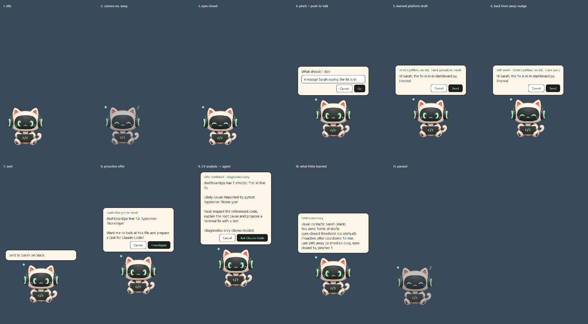

# Pette check report

- **When:** 2026-10-11 15:36 local, took 61s
- **Code:** `dev` @ `94a5da0` (checks run on the working tree before this report was committed)
- **Result:** 6 pass, 1 fail, 5 skipped, 2 info
- **Regenerate:** `py tools/run_checks.py` (add `--webhooks` to also post a test message)

| Check | Result | Detail |
|---|---|---|
| Environment | INFO | Windows 11 (10.0.26200), Python 3.13.9, PySide6 6.8.3, OpenCV 5.0.0, MediaPipe 1.1.0, openai 2.46.0 |
| Unit + integration tests | PASS | 131/131 passed, 0 failed, 0 errors, 0 skipped in 25.4s |
| MediaPipe models | PASS | face + hand landmarker present |
| Webcam: face / eyes / hands (live) | SKIP | --no-camera |
| Foreground app detection | PASS | foreground = Code.exe -> show Pette |
| VS Code bridge snapshot | SKIP | no snapshot at ~/.flowstate_current.json (extension not installed or no file open) |
| db cache + world model | PASS | write -> learn -> read round trip in a temp db |
| Groq (qwen/qwen3.8-27b / whisper-large-v3-turbo) | PASS | 1-token request succeeded |
| Claude Code agent (live, read-only) | SKIP | --no-agent |
| ElevenLabs voice agent | **FAIL** | agent answers but never called propose_message: add the client tools from tools/elevenlabs_agent_tools.json in the ElevenLabs dashboard |
| Hermes agent | INFO | installed (adapter unit-tested; live run not part of checks) |
| Slack webhook | SKIP | configured; live post skipped (run with --webhooks) |
| Discord webhook | SKIP | configured; live post skipped (run with --webhooks) |
| UI states (screenshots) | PASS | 11/11 states rendered on the real display -> test_results/ui_states.png |

## Tests by file

| File | Passed | Failed |
|---|---|---|
| `test_agents` | 16 | 0 |
| `test_brain` | 15 | 0 |
| `test_context` | 4 | 0 |
| `test_cv_flow` | 14 | 0 |
| `test_db` | 11 | 0 |
| `test_dispatch` | 7 | 0 |
| `test_e2e` | 3 | 0 |
| `test_eleven` | 14 | 0 |
| `test_focus` | 10 | 0 |
| `test_llm` | 4 | 0 |
| `test_message_cv` | 12 | 0 |
| `test_pipeline` | 8 | 0 |
| `test_sandbox` | 4 | 0 |
| `test_vision` | 6 | 0 |
| `test_voice` | 3 | 0 |

## UI states

Privacy: live checks record counts and timings only. No camera frames, screen images, file contents or message text were saved.
